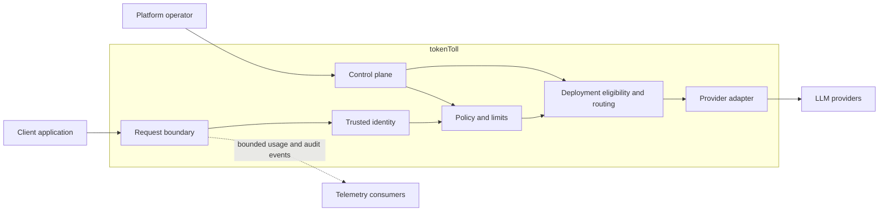

# tokenToll

**A provider-neutral, multi-tenant gateway for reliable and governed access to
large language models.**

tokenToll aims to give application teams one consistent interface for multiple
LLM providers while centralizing routing, reliability, security, usage policy,
and observability. Instead of every product rebuilding provider integrations and
operational safeguards, the gateway is designed to make those concerns explicit,
testable, and reusable.

## Project goals

- Keep application contracts independent of provider-specific SDKs.
- Route requests across eligible model deployments with bounded failure handling.
- Support non-streaming and streaming traffic with cancellation and cleanup.
- Enforce tenant-aware identity, quotas, budgets, credentials, and governance.
- Produce trustworthy usage and audit data without blocking the request path.
- Measure performance through reproducible benchmarks rather than unsupported
  claims.

## Architecture

tokenToll sits between client applications and model providers. Clients send a
normalized request to the gateway; provider-specific translation ends at an
adapter boundary. Operators manage deployments and policy through a separate
control plane, while usage and audit events leave the request path
asynchronously.



### Architectural building blocks

| Area                | Responsibility                                                                                 |
| ------------------- | ---------------------------------------------------------------------------------------------- |
| Request boundary    | Validate input, establish request context, and expose stable gateway contracts.                |
| Identity and policy | Derive trusted tenant scope and apply authorization, limits, budgets, and governance.          |
| Deployment catalog  | Describe provider/model targets, capabilities, context limits, health, and token prices.       |
| Router              | Filter eligible deployments and apply explicit selection and resilience policies.              |
| Provider adapters   | Translate normalized requests, responses, streams, usage, and errors at the provider boundary. |
| Usage pipeline      | Emit bounded asynchronous usage and audit events away from the latency-sensitive request path. |
| Control plane       | Manage tenants, keys, credentials, deployments, pricing, budgets, and reporting inputs.        |

## Architecture principles

The design keeps provider behavior behind adapters, separates the
latency-sensitive data plane from administrative control-plane work, and treats
tenant identity as a data-boundary invariant. Concurrency, queues, retries,
bodies, buffers, timers, and cache lifetimes must remain bounded. Sensitive
prompts, completions, credentials, and authorization data are excluded from logs
by default.

## Technology

- Node.js 22+, TypeScript, and Fastify
- Bun for dependency management and task execution
- ESLint and Prettier for static quality checks
- Bun's test runner for unit and integration coverage
- OpenSpec for specification-driven delivery

## Run locally

```sh
bun install --frozen-lockfile
bun run build
HOST=127.0.0.1 bun run start
```

The service starts on port `3000` by default. Verify liveness with:

```sh
curl http://127.0.0.1:3000/health
```

```json
{ "status": "ok" }
```

### Runtime configuration

| Variable             | Default   | Valid values                                   |
| -------------------- | --------- | ---------------------------------------------- |
| `HOST`               | `0.0.0.0` | A non-empty string after whitespace trimming   |
| `PORT`               | `3000`    | A decimal integer from `1` through `65535`     |
| `SHUTDOWN_GRACE_MS`  | `10000`   | A decimal integer from `1` through `60000` ms  |
| `REQUEST_TIMEOUT_MS` | `30000`   | A decimal integer from `1` through `300000` ms |

Invalid configuration fails before the HTTP listener opens. `GET /health`
reports process liveness only; it does not claim downstream readiness.

## Mock chat completions

`POST /v1/chat/completions` accepts the following strict subset. No credentials
are required. The only model alias is `mock-chat`; every request goes to one
fixed deterministic mock adapter without external network access. Omitting
`stream` or sending `"stream":false` returns one JSON completion; sending
`"stream":true` returns a Server-Sent Events stream.

| Field                   | Accepted value                                                         |
| ----------------------- | ---------------------------------------------------------------------- |
| `model`                 | Required exact string `mock-chat`                                      |
| `messages`              | Required array of 1–128 messages                                       |
| `messages[].role`       | `system`, `user`, or `assistant`                                       |
| `messages[].content`    | Non-blank text string, preserved exactly                               |
| `max_completion_tokens` | Optional integer from 1 through 8192, mapped to a neutral output limit |
| `stream`                | Optional boolean; `false` or omitted selects JSON, `true` selects SSE  |
| `stream_options`        | Optional object containing only boolean `include_usage`                |

Only the listed root and message fields are accepted. Explicit nulls, type
coercion, and unsupported fields are rejected, including `max_tokens`, `n`,
`temperature`, `tools`, `response_format`, message `name`, and tenant
identifiers. `stream_options` is invalid unless `stream` is exactly `true`; an
unknown `stream_options` field or a non-boolean `include_usage` is likewise
rejected with 400 `invalid_request` before any adapter invocation. `stream`
selects the transport only and never enters the neutral request.

Requests must use `application/json` with an optional UTF-8 charset, with no
compression (`identity` encoding is accepted). The body limit is 65,536 UTF-8
bytes inclusive. Each application instance admits at most 64 active adapter
invocations; a streaming request holds its permit for the full lifetime of its
event iterator, and extra valid requests fail immediately with no queue or
retry. This bounds generation work, rather than all inbound sockets or
transport buffers.

### Non-streaming example

```sh
curl http://127.0.0.1:3000/v1/chat/completions \
  -H 'Content-Type: application/json' \
  -d '{"model":"mock-chat","messages":[{"role":"user","content":"Hello"}],"max_completion_tokens":16,"stream":false}'
```

The response has a unique `chatcmpl-` id, an integer Unix-seconds `created`
timestamp, `object: "chat.completion"`, `model: "mock-chat"`, one choice at index
0 with assistant content `Mock response.` and `finish_reason: "stop"`, and usage:

```json
{
  "prompt_tokens": 1,
  "completion_tokens": 1,
  "total_tokens": 2,
  "prompt_tokens_details": { "cached_tokens": 0 }
}
```

This content and usage are fixed synthetic fixture data, independent of the
submitted messages. They do not represent real inference or measured tokens.
The wire boundary also translates neutral `length` and `content_filter` finish
reasons. Prompt usage includes cached input; cached tokens are not added again
to the total. Completion content is limited to 8192 UTF-8 bytes and the entire
serialized success body to 65,536 bytes; overflow is rejected without
truncation.

### Streaming example

```sh
curl -N http://127.0.0.1:3000/v1/chat/completions \
  -H 'Content-Type: application/json' \
  -d '{"model":"mock-chat","messages":[{"role":"user","content":"Hello"}],"stream":true,"stream_options":{"include_usage":true}}'
```

`curl -N` disables client buffering so frames print as they arrive. In the
output below, `chatcmpl-<uuid>` and `<unix-seconds>` are placeholders for
volatile values: each stream generates one fresh `chatcmpl-` id and one
Unix-seconds `created` timestamp and repeats both unchanged in every chunk.

```text
data: {"id":"chatcmpl-<uuid>","object":"chat.completion.chunk","created":<unix-seconds>,"model":"mock-chat","choices":[{"index":0,"delta":{"content":"Mock "},"finish_reason":null}]}

data: {"id":"chatcmpl-<uuid>","object":"chat.completion.chunk","created":<unix-seconds>,"model":"mock-chat","choices":[{"index":0,"delta":{"content":"response."},"finish_reason":null}]}

data: {"id":"chatcmpl-<uuid>","object":"chat.completion.chunk","created":<unix-seconds>,"model":"mock-chat","choices":[{"index":0,"delta":{},"finish_reason":"stop"}]}

data: {"id":"chatcmpl-<uuid>","object":"chat.completion.chunk","created":<unix-seconds>,"model":"mock-chat","choices":[],"usage":{"prompt_tokens":1,"completion_tokens":1,"total_tokens":2,"prompt_tokens_details":{"cached_tokens":0}}}

data: [DONE]
```

### Streaming behavior

- **Headers and framing.** A streaming response uses HTTP 200 with
  `Content-Type: text/event-stream; charset=utf-8`, `Cache-Control: no-cache`,
  and no compression. Every frame is `data: <json>\n\n` and the terminal frame
  is `data: [DONE]\n\n`. Headers commit only with the first frame, so a
  provider, validation, or deadline failure before that point is answered with
  the JSON status table below instead; a client that disconnects first receives
  no SSE body.
- **Chunk shape.** Every chunk carries `object: "chat.completion.chunk"`, one
  `chatcmpl-` id, an integer Unix-seconds `created`, and `model: "mock-chat"`,
  identical across the whole stream. Content arrives as
  `choices: [{"index":0,"delta":{"content":"<text>"},"finish_reason":null}]`,
  and exactly one finish chunk follows with `delta: {}` and the finish reason.
  No deployment, provider, or adapter metadata appears. The default mock emits
  the two content deltas `Mock ` and `response.` — concatenating to
  `Mock response.` — and finishes with `stop`. Streamed content and usage are
  the same fixed synthetic fixture data as the non-streaming response, not
  measured inference.
- **Usage selection.** With `"include_usage":true`, exactly one usage chunk
  with `choices: []` follows the finish chunk and precedes `[DONE]`, using the
  same usage mapping as the JSON response. When `include_usage` is absent or
  `false`, no usage chunk is emitted even though the adapter's usage event is
  still validated. If usage was requested and the stream completes without
  one, the stream ends with `invalid_provider_response` and no `[DONE]`.
- **Mid-stream failures.** After the first frame has committed, an adapter,
  validation, deadline, or shutdown failure emits exactly one
  `data: {"error":{...}}\n\n` frame with the same fixed envelope, type, and
  code as the table below; the HTTP status stays 200 and the response closes
  without `[DONE]`. A deadline that expires after content emits
  `upstream_timeout`, and shutdown emits `internal_error`. A client
  disconnect instead aborts the adapter work and ends the stream quietly with
  no frame — the vanished client cannot receive one. Frames contain no
  exception messages, submitted values, provider payloads, or credentials. A
  stream that ends without `[DONE]` is incomplete; a cancelled or failed
  stream gets no fabricated completion marker or usage counts.
- **Bounds and backpressure.** Streamed content totals at most 8192 UTF-8
  bytes across all deltas: reaching exactly that limit completes normally,
  while the next delta that would exceed it ends the stream with
  `invalid_provider_response`, without `[DONE]` and without emitting the
  overflowing delta. Each serialized frame is at most 65,536 UTF-8 bytes. At
  most one frame is in flight at a time — the next adapter event is read only
  after the current frame has drained — so a slow consumer pauses the stream
  instead of growing a buffer. `GET /health` is independent of the
  64-invocation cap.
- **Deadline and shutdown.** `REQUEST_TIMEOUT_MS` (default `30000`; see the
  runtime configuration table) applies from admission to every streaming
  request. On expiry the adapter work is aborted and the stream terminates
  through the applicable error path — the JSON status table before the first
  frame, one error frame after it — and the deadline timer is cleared on every
  exit path. The non-streaming path uses no timer. On `SIGINT` or `SIGTERM`,
  active streams are aborted and end without `[DONE]`, their permits are
  released, and the HTTP listener closes within `SHUTDOWN_GRACE_MS`.

Errors use exactly `{"error":{"message":"<fixed safe message>","type":"<type>","param":null,"code":"<code>"}}`.
Only `model_not_found` uses `param: "model"`. Submitted values and adapter
diagnostics are excluded, and no retry instructions are emitted. The same
envelope, type, and code appear inside the SSE error frame after a streaming
response has committed.

| HTTP | Type                    | Code                        | Meaning                              |
| ---- | ----------------------- | --------------------------- | ------------------------------------ |
| 400  | `invalid_request_error` | `invalid_request`           | Invalid input or malformed JSON      |
| 404  | `invalid_request_error` | `model_not_found`           | Unknown model in a valid request     |
| 413  | `invalid_request_error` | `request_too_large`         | Request byte limit exceeded          |
| 415  | `invalid_request_error` | `unsupported_media_type`    | Unsupported media, charset, encoding |
| 429  | `rate_limit_error`      | `upstream_rate_limited`     | Adapter reports a rate limit         |
| 500  | `server_error`          | `internal_error`            | Unexpected exception                 |
| 502  | `server_error`          | `upstream_error`            | Adapter reports provider failure     |
| 502  | `server_error`          | `invalid_provider_response` | Invalid or oversized adapter output  |
| 503  | `server_error`          | `upstream_unavailable`      | Adapter reports unavailability       |
| 503  | `server_error`          | `gateway_busy`              | Local active-call cap reached        |
| 504  | `server_error`          | `upstream_timeout`          | Adapter timeout or request deadline  |

Excluded from this milestone, as later roadmap scope: live providers, routing,
retries and fallback, authentication, tenant quotas, persistence, telemetry,
caching, guardrails, benchmarks, resumable streams, multiple choices, tool
calls, heartbeats, compression, and control-plane or tenant administration. The
health endpoint and graceful signal shutdown remain available. Throughput and
latency objectives remain unverified.

## Development

```sh
bun run format:check
bun run lint
bun run typecheck
bun run test
bun run build
bun run check
```

`bun run check` is the non-mutating aggregate verification command.

## Documentation

- [Vision](docs/vision.md)
- [Requirements](docs/requirements.md)
- [Architecture](docs/architecture.md)
- [Roadmap](docs/roadmap.md)
- [Architecture decisions](docs/adr/README.md)
