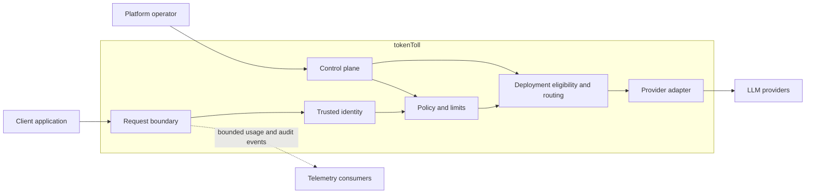

# tokenToll

**A provider-neutral, multi-tenant gateway for reliable and governed access to
large language models.**

tokenToll aims to give application teams one consistent interface for multiple
LLM providers while centralizing routing, reliability, security, usage policy,
and observability. Instead of every product rebuilding provider integrations and
operational safeguards, the gateway is designed to make those concerns explicit,
testable, and reusable.

## Project goals

- Keep application contracts independent of provider-specific SDKs.
- Route requests across eligible model deployments with bounded failure handling.
- Support non-streaming and streaming traffic with cancellation and cleanup.
- Enforce tenant-aware identity, quotas, budgets, credentials, and governance.
- Produce trustworthy usage and audit data without blocking the request path.
- Measure performance through reproducible benchmarks rather than unsupported
  claims.

## Architecture

tokenToll sits between client applications and model providers. Clients send a
normalized request to the gateway; provider-specific translation ends at an
adapter boundary. Operators manage deployments and policy through a separate
control plane, while usage and audit events leave the request path
asynchronously.



### Architectural building blocks

| Area                | Responsibility                                                                                 |
| ------------------- | ---------------------------------------------------------------------------------------------- |
| Request boundary    | Validate input, establish request context, and expose stable gateway contracts.                |
| Identity and policy | Derive trusted tenant scope and apply authorization, limits, budgets, and governance.          |
| Deployment catalog  | Describe provider/model targets, capabilities, context limits, health, and token prices.       |
| Router              | Filter eligible deployments and apply explicit selection and resilience policies.              |
| Provider adapters   | Translate normalized requests, responses, streams, usage, and errors at the provider boundary. |
| Usage pipeline      | Emit bounded asynchronous usage and audit events away from the latency-sensitive request path. |
| Control plane       | Manage tenants, keys, credentials, deployments, pricing, budgets, and reporting inputs.        |

## Architecture principles

The design keeps provider behavior behind adapters, separates the
latency-sensitive data plane from administrative control-plane work, and treats
tenant identity as a data-boundary invariant. Concurrency, queues, retries,
bodies, buffers, timers, and cache lifetimes must remain bounded. Sensitive
prompts, completions, credentials, and authorization data are excluded from logs
by default.

## Technology

- Node.js 22+, TypeScript, and Fastify
- Bun for dependency management and task execution
- ESLint and Prettier for static quality checks
- Bun's test runner for unit and integration coverage
- OpenSpec for specification-driven delivery

## Run locally

```sh
bun install --frozen-lockfile
bun run build
HOST=127.0.0.1 bun run start
```

The service starts on port `3000` by default. Verify liveness with:

```sh
curl http://127.0.0.1:3000/health
```

```json
{ "status": "ok" }
```

### Runtime configuration

| Variable            | Default   | Valid values                                  |
| ------------------- | --------- | --------------------------------------------- |
| `HOST`              | `0.0.0.0` | A non-empty string after whitespace trimming  |
| `PORT`              | `3000`    | A decimal integer from `1` through `65535`    |
| `SHUTDOWN_GRACE_MS` | `10000`   | A decimal integer from `1` through `60000` ms |

Invalid configuration fails before the HTTP listener opens. `GET /health`
reports process liveness only; it does not claim downstream readiness.

## Development

```sh
bun run format:check
bun run lint
bun run typecheck
bun run test
bun run build
bun run check
```

`bun run check` is the non-mutating aggregate verification command.

## Documentation

- [Vision](docs/vision.md)
- [Requirements](docs/requirements.md)
- [Architecture](docs/architecture.md)
- [Roadmap](docs/roadmap.md)
- [Architecture decisions](docs/adr/README.md)
