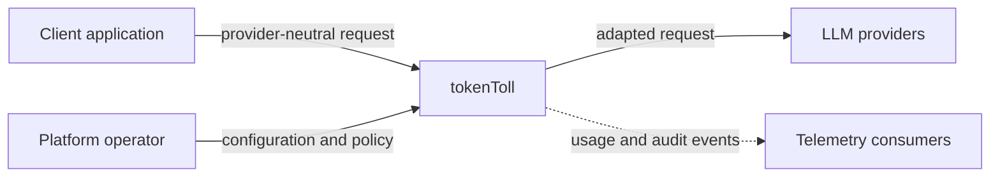
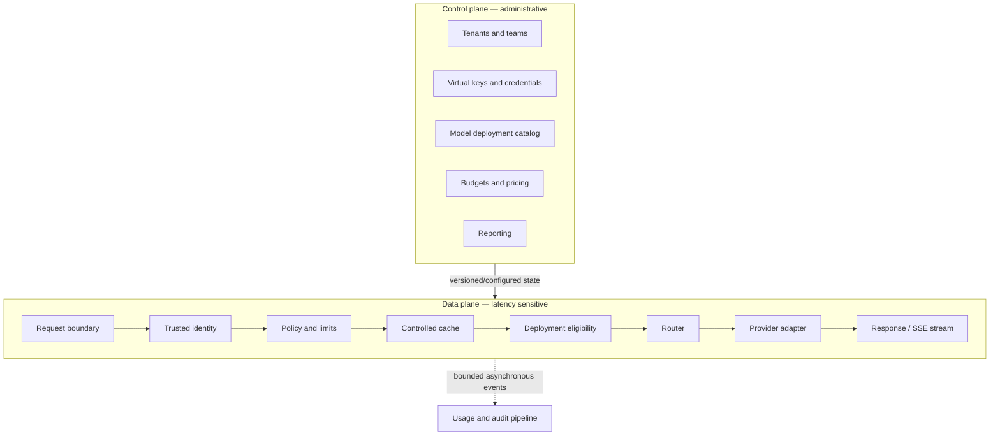
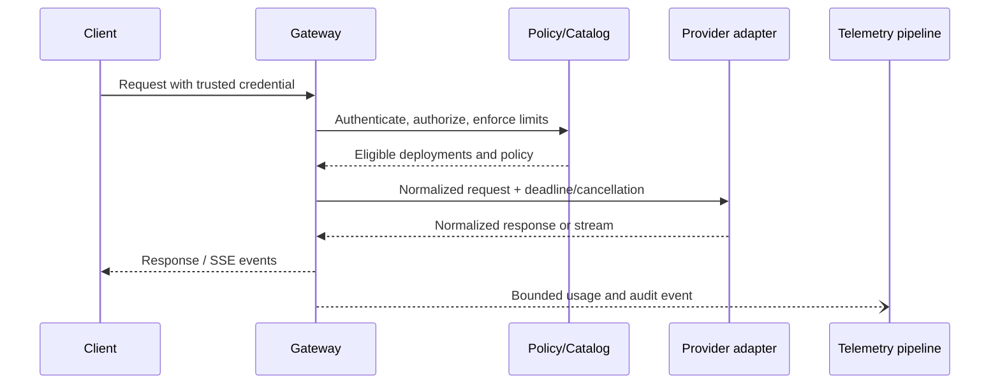

# Architecture

This document describes the intended system boundaries. M1–M3 are implemented and archived; components and capabilities assigned to M4–M10 are conceptual and do not imply implementation.

## System Context

Clients depend on a gateway contract rather than a provider API. Operators administer deployments and policy through a control plane. Provider integrations and telemetry destinations remain outside the core boundary.

## Operational Planes and Components

This is a target-state map, not the implemented M3 scope. Authentication, caching, routing, providers, telemetry, persistence, and security guardrails arrive only in their roadmap milestones.

## Accepted Boundaries

- **Operational planes:** Keep administrative control-plane work and synchronous telemetry persistence off the request hot path. See [ADR-0001](adr/0001-separate-operational-planes.md).
- **Provider boundary:** Gateway contracts stay provider-neutral; explicit adapters own provider translation and error normalization. See [ADR-0002](adr/0002-use-provider-neutral-contracts.md).
- **Catalog model:** Every routable provider/model target is one model deployment entity. Provider labels and origin are attributes, not architectural branches. See [ADR-0003](adr/0003-unify-model-deployments.md).
- **Telemetry boundary:** Usage and audit events leave the request path asynchronously through a bounded mechanism. See [ADR-0004](adr/0004-keep-telemetry-off-request-path.md).

The foundation technology constraints are Node.js, TypeScript, and Fastify, with Bun used for package management and task execution. These choices do not approve later storage, messaging, authentication, or deployment technologies.

## Provider-Neutral Interfaces

The conceptual interfaces are a normalized request, normalized response or stream event, normalized error, provider adapter, model-deployment descriptor, and cancellation/deadline context. Exact fields belong in the M2 OpenSpec change. Provider-specific SDK types must terminate at the adapter boundary.

Adapters translate inputs, outputs, streaming events, usage, and provider errors. Error normalization must preserve enough information to classify retryability without exposing provider coupling to clients.

## Unified Model Deployment Catalog

A model deployment combines a provider/model target with capabilities, context limits, tenant/key policy, governance restrictions, credentials, availability, health, circuit state, and configured input/output/cache-token rates. Routing first filters for eligibility. Cost-aware selection then compares consistent rate fields. Any non-cost preference must be explicit operator policy.

## Request Lifecycle

Depending on the milestone, intermediate steps may not exist yet. Deadline and cancellation context must flow through every downstream operation. Failures must normalize at boundaries, and cleanup must run for success, error, timeout, and client abort.

## Tenant Isolation and Security

Trusted authentication establishes tenant identity; client-supplied tenant identifiers alone never establish scope. Tenant context must be applied at every policy, cache, catalog, accounting, and persistence boundary. Virtual keys are stored only as cryptographic hashes, provider credentials use authenticated encryption, and sensitive payloads are excluded from logs by default. Exact identity and persistence designs remain unapproved.

## Reliability and Resource Lifecycle

External providers are unreliable dependencies. Timeouts, retry counts, concurrency, queues, bodies, buffers, and cache lifetimes require finite limits. Retryability must be classified, retry storms prevented, and fallback must not duplicate non-idempotent work. Graceful shutdown stops new work and closes listeners, upstream connections, timers, pools, queues, and workers. Streaming must respect backpressure and release sockets and buffers on every termination path.

## Performance Boundary

The 5,000 RPS and p95 gateway-overhead-below-5-ms goals are unverified. Benchmarks must use deterministic mock providers and document environment, workload, upstream treatment, throughput, latency percentiles, errors, CPU, memory, and event-loop lag. Design optimization follows measured evidence.

## Known Unknowns and Tradeoffs

The following require future approval: OpenAI-compatible endpoint/schema coverage; persistence and data ownership; deployment platform; authentication and RBAC model; telemetry transport, delivery guarantees, and storage; routing scoring and tie-breaking; retry/fallback idempotency policy; Redis topology and cache semantics; guardrail mechanisms and failure policy; and benchmark tooling/workload. PostgreSQL is excluded from M1 but not selected by the requirements. The [ADR register](adr/README.md) tracks these without treating them as accepted decisions.
